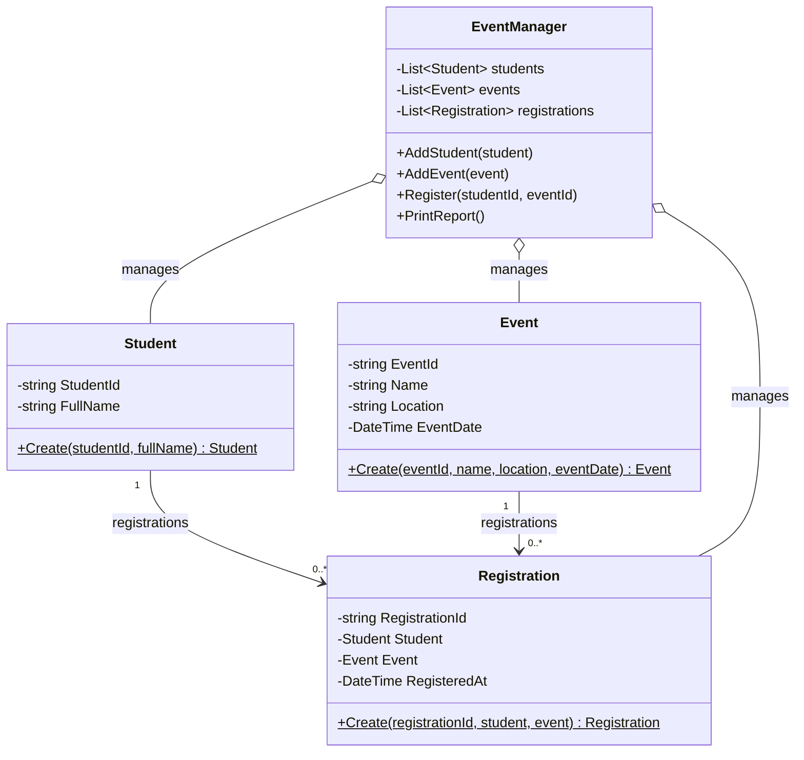

# EduHub – Class Diagram

## Relationships and foreign keys

- Một Student có thể có nhiều Registration.
- Một Event có thể có nhiều Registration.
- Mỗi Registration tham chiếu đến một Student và một Event.
- Nếu lưu vào cơ sở dữ liệu quan hệ, Registration có thể sử dụng StudentId và EventId làm khóa ngoại.
- Các thuộc tính được bảo vệ bằng private setter; các đối tượng được tạo thông qua phương thức Create().